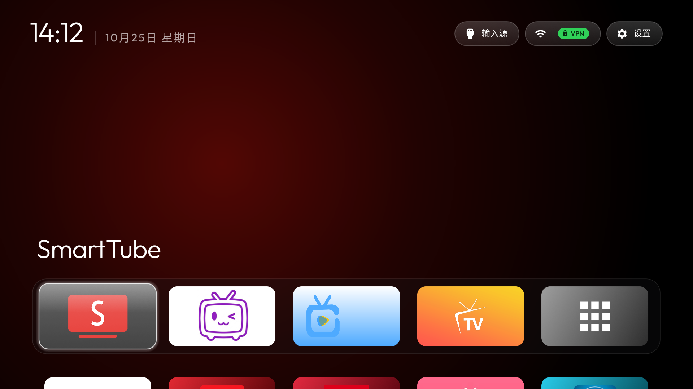
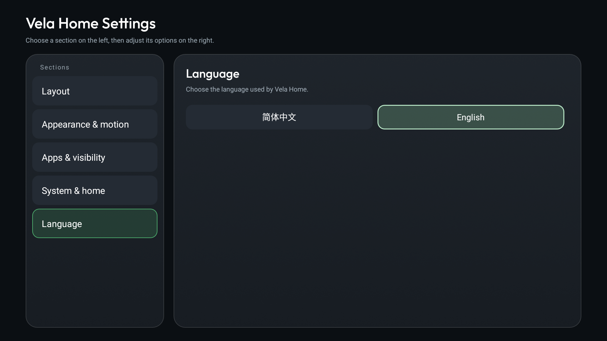

# Vela Home for HaQu Q1 Pro

[](https://github.com/403323726/Vela-Home-HQHYQ1P/releases/latest)

**简体中文** | [English](README.en.md)


> 一个面向 **哈趣 Q1 Pro（HQHYQ1P，Android 9 / SDK 28）** 的 Apple TV 风格 Android TV 桌面，以及一套让 AI Agent 在真实投影仪上安全适配、验证和恢复的实践指南。
>
> 本项目是非官方社区项目，与哈趣、当贝、CVTE 或 CleanYourTV 上游作者没有隶属关系。修改设备前请先阅读安全说明。

## 这个仓库解决什么问题

很多国产投影仪把开发者选项、ADB 或原生 Android 设置藏了起来。仅靠“安装一个设置 APK”通常不够，因为不同固件会隐藏不同的 Activity，桌面、HDMI、Wi-Fi 和系统设置也常常由厂商组件接管。

本仓库提供三件事：

1. **一个可用的 Vela Home 构建**：`com.gathin.tvhome`，支持中文和 English，可作为默认 Home。
2. **一套 AI Agent 工作流**：让 Agent 先发现设备事实，再做小步、可回滚的适配，而不是直接批量停用系统包。
3. **真实设备记录**：记录哈趣 Q1 Pro 已验证的包名、Activity、HDMI 路径、风险点和恢复方式。

## 功能概览

- Apple TV 风格黑色桌面、程序坞和应用网格
- 中英文切换，语言偏好持久保存
- 应用隐藏、应用信息、排序和移动
- 系统应用文件夹
- HDMI / 输入源入口
- Wi-Fi 与厂商设置入口
- 可选的当贝OS后台限制
- 不申请网络权限，不包含分析、遥测或网络轮询





## 下载

| 文件 | 用途 |
|---|---|
| [`apk/CleanYourTV-HQHYQ1P-2.8.7.apk`](apk/CleanYourTV-HQHYQ1P-2.8.7.apk) | Vela Home 成品 APK，版本 `2.8.7 (21)` |
| [`adb/TV-ADB-Enabler-3.0.apk`](adb/TV-ADB-Enabler-3.0.apk) | 用户提供的第三方 ADB 控制器 APK，包名 `jiujiutv.jiujiu.adb` |
| [`adb/ADBRecovery.apk`](adb/ADBRecovery.apk) | 应急恢复 ADB 端口的小工具 |
| [`SHA256SUMS.txt`](SHA256SUMS.txt) | 所有发布文件的 SHA-256 |

所有下载文件都应先核对哈希。APK 只从本仓库的固定版本或你自己的构建中安装，不要从陌生网盘或群聊转发版本安装。

## 重要安全提示

ADB 的网络端口 `5555` 是明文协议。开启后，同一局域网内的设备可能尝试连接。

- 只在可信的家庭或实验室网络中开启。
- 不要把 `5555` 映射到公网，也不要在公共 Wi-Fi 下长期开启。
- 投影仪弹出“允许 USB 调试吗？”时必须由你本人确认。
- 不需要调试时，关闭 Network/ADB debugging；如果你像本仓库的参考设备一样需要长期保留 ADB，请至少限制网络范围。
- 第三方 ADB APK 会申请 `WRITE_SECURE_SETTINGS`、网络和开机广播等权限。请先阅读 [`adb/README.md`](adb/README.md)，确认你接受这些权限后再安装。

## 快速开始：安装 Vela Home

以下命令以 Windows PowerShell 为例。把 `<投影仪局域网 IP>` 替换成你自己的地址，不要把真实地址提交到仓库。

### 1. 开启 ADB

把 `adb/TV-ADB-Enabler-3.0.apk` 复制到 U 盘，或通过文件管理器传到投影仪，安装并打开。按应用提示开启 ADB，确认投影仪和电脑在同一网络。

然后验证端口和授权：

```powershell
$env:TV_HOST = "<投影仪局域网 IP>"
python -I tools/tv.py --probe
```

如果出现授权提示，请在投影仪上选择允许。成功时应能看到型号、Android 版本和 SDK 信息。

### 2. 安装 APK

```powershell
python -I tools/b64push.py apk/CleanYourTV-HQHYQ1P-2.8.7.apk /data/local/tmp/vela-home.apk
python -I tools/tv.py "pm install -r /data/local/tmp/vela-home.apk"
python -I tools/tv.py "rm -f /data/local/tmp/vela-home.apk"
```

`pm install -r` 会保留应用数据。安装完成后，先不要停用原桌面。

### 3. 设为默认 Home

```powershell
python -I tools/tv.py "cmd package set-home-activity --user 0 com.gathin.tvhome/.MainActivity"
python -I tools/tv.py "am start -W -n com.gathin.tvhome/.MainActivity"
```

确认 Home 键能回到 Vela Home：

```powershell
python -I tools/tv.py "cmd package resolve-activity --brief -a android.intent.action.MAIN -c android.intent.category.HOME"
```

结果应包含：

```text
com.gathin.tvhome/.MainActivity
```

### 4. 验证基本功能

至少检查：

- Home 键回到 Vela Home
- Dock 应用可以打开
- “输入源”能列出 HDMI
- Wi-Fi 按钮能打开厂商网络页
- 桌面设置可以打开并切换语言
- ADB 控制器仍在应用列表中
- 原当贝OS桌面仍处于启用状态

## 使用 AI Agent 适配自己的设备

不要直接对 Agent 说“帮我精简电视”。这个指令太宽泛，容易误停用系统组件。推荐让 Agent 按“发现 → 备份 → 小步修改 → 截图验证 → 恢复”的循环工作。

### 推荐开场

把本仓库交给 Agent，并要求它先读取：

- [`AGENTS.md`](AGENTS.md)
- [`docs/AI-AGENT-GUIDE.zh-CN.md`](docs/AI-AGENT-GUIDE.zh-CN.md)
- [`docs/SAFETY.md`](docs/SAFETY.md)

可直接复制的提示词在 [`prompts/adapt-device.zh-CN.md`](prompts/adapt-device.zh-CN.md)。

### Agent 必须先做的事

1. 通过 ADB 读取型号、SDK、分辨率、Home Activity、包列表和已停用包列表。
2. 把输出保存到本地 `backup/` 或 `work/` 目录。
3. 按“厂商遥测/广告”“可替换应用”“系统核心组件”分类，而不是按包名猜用途。
4. 对每个不确定的包先运行 `dumpsys package <包名>`，向用户确认后再处理。
5. 每次只改一个或一小批组件，并立即截图和复查。
6. 永远保留恢复脚本和原桌面入口。

### 绝不能交给 Agent 自动执行的操作

- `pm uninstall` 系统包
- 停用 `com.android.*`、`com.google.android.*` 等核心组件
- 打开工厂、生产、AT 或测试菜单
- 在没有恢复路径时停用原桌面
- 把 ADB 端口暴露到公网
- 把真实 IP、Wi-Fi 名、序列号、ADB 私钥或账号信息提交到 Git

## 哈趣 Q1 Pro 已验证信息

| 项目 | 值 |
|---|---|
| 型号 | HQHYQ1P |
| Android | 9 / SDK 28 |
| 分辨率 | 1920×1080 |
| 物理密度 | 240 |
| Vela Home 包名 | `com.gathin.tvhome` |
| 默认 Home | `com.gathin.tvhome/.MainActivity` |
| 原桌面包 | `com.dangbei.leard.leradlauncher` |
| 厂商设置 | `com.dangbei.haqusetting/.ui.HomeActivity` |
| ADB 控制器 | `jiujiutv.jiujiu.adb` |

更多设备细节和已验证的 Activity 见 [`docs/DEVICE-HQHYQ1P.md`](docs/DEVICE-HQHYQ1P.md)。

### 当贝OS的处理

在参考固件上，单独停用当贝OS的 `LauncherActivity` 会被系统以 `SecurityException` 拒绝。保守方案是：

- 保持 `com.dangbei.leard.leradlauncher` 包启用
- 让 Vela Home 成为默认 Home
- 可选地限制当贝OS后台运行
- 保留 [`scripts/restore-dangbei-background.ps1`](scripts/restore-dangbei-background.ps1) 作为恢复入口

不要在未验证恢复路径的情况下直接停用整个厂商桌面包。

## 构建源码

源码在 [`launcher/`](launcher/)。需要 JDK 17+、Android SDK 34 和 Python 3。

```powershell
py -m venv tools/venv
tools\venv\Scripts\python.exe -m pip install -r tools/requirements.txt
$env:JAVA_HOME = "<JDK 目录>"
$env:ANDROID_HOME = "<Android SDK 目录>"
$env:TV_HOST = "<投影仪局域网 IP>"
powershell -ExecutionPolicy Bypass -File launcher/build-and-install.ps1 -TvHost $env:TV_HOST -StockLauncher none
```

`-StockLauncher none` 表示**只安装和设置 Home，不停止原桌面**。这是推荐的第一次安装方式。确认新桌面稳定后，再由你决定是否做后台限制。

## 恢复

- 重新启用当贝OS后台运行：`scripts/restore-dangbei-background.ps1`
- 将原桌面设为 Home：脚本中的 `-MakeDefault` 选项
- ADB 端口丢失：在投影仪上安装并打开 `adb/ADBRecovery.apk`
- 完整恢复思路：见 [`docs/SAFETY.md`](docs/SAFETY.md)

恢复脚本只执行显式的 `pm enable`、Home 切换和后台权限恢复，不会卸载 Vela Home。

## 仓库结构

```text
Vela-Home-HQHYQ1P/
├─ launcher/                 Vela Home Android 源码
├─ apk/                      已构建 APK
├─ adb/                      ADB 开启与恢复工具
├─ assets/                   方形图标和截图
├─ docs/                     设备说明、安全和 AI Agent 指南
├─ prompts/                  可直接复制的 Agent 提示词
├─ scripts/                  构建、检查和恢复脚本
├─ tools/                    ADB TCP 客户端与上传工具
├─ AGENTS.md                 Agent 必须遵守的设备安全规则
├─ LICENSE                   MIT
└─ NOTICE.md                 上游与第三方组件说明
```

## 已知限制

- 本仓库的测试结果是针对 **HQHYQ1P / Android 9 / 特定固件** 的，不保证其他哈趣型号或固件完全一致。
- 某些固件不允许单独停用厂商桌面 Activity，也不允许普通应用修改其他组件状态。
- Android 9 的电视系统可能没有标准 `ACTION_HOME_SETTINGS`；默认桌面选择通常需要厂商设置或 ADB。
- 第三方 ADB APK 不是本项目维护的软件，不能保证其未来版本、来源或行为不变。
- 如果 HDMI 没有接入信号源，看到黑屏或“无信号”浮动小窗是正常现象。

## 贡献

欢迎提交：

- 其他哈趣型号的实测记录
- 包名和 Activity 的 `dumpsys` 证据
- 恢复脚本
- 不包含个人信息的中英文文档
- 不涉及 root、绕过商店保护或公开他人设备的修复

提交前请删除 IP、Wi-Fi 名、序列号、账号、ADB 私钥和设备截图中的个人信息。

## 许可与归属

Vela Home 基于 [CleanYourTV](https://github.com/Gathin23/cleanyourtv) 的 launcher 修改，遵循 MIT License。原项目版权归 Gathin 及贡献者所有。详细归属、字体许可和第三方 APK 说明见 [`NOTICE.md`](NOTICE.md)。
